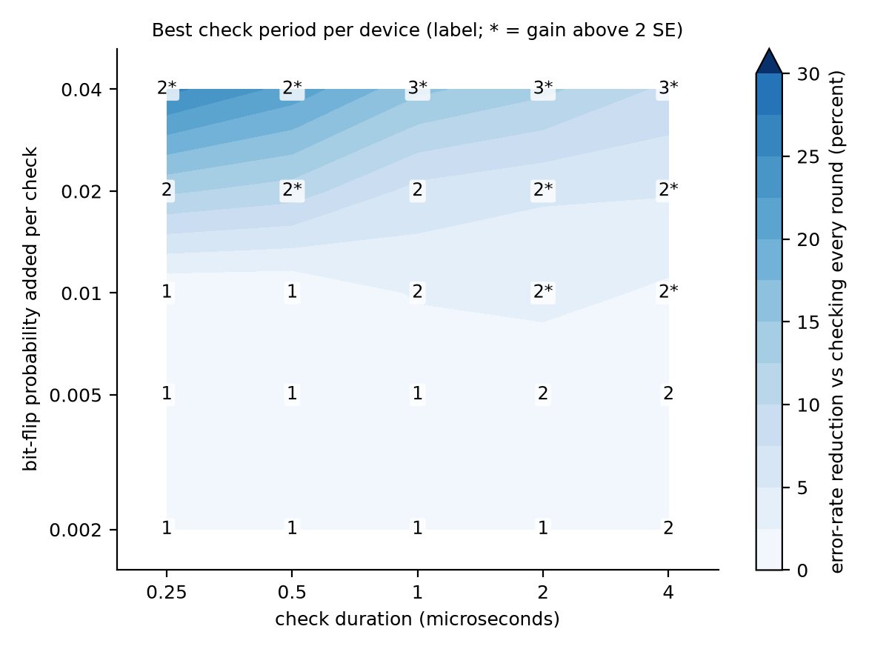
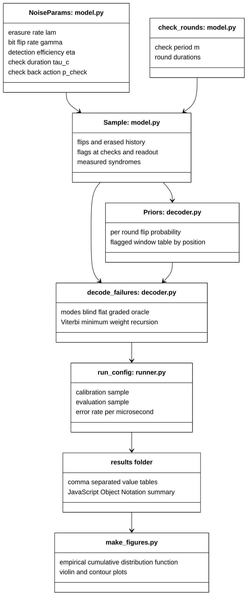
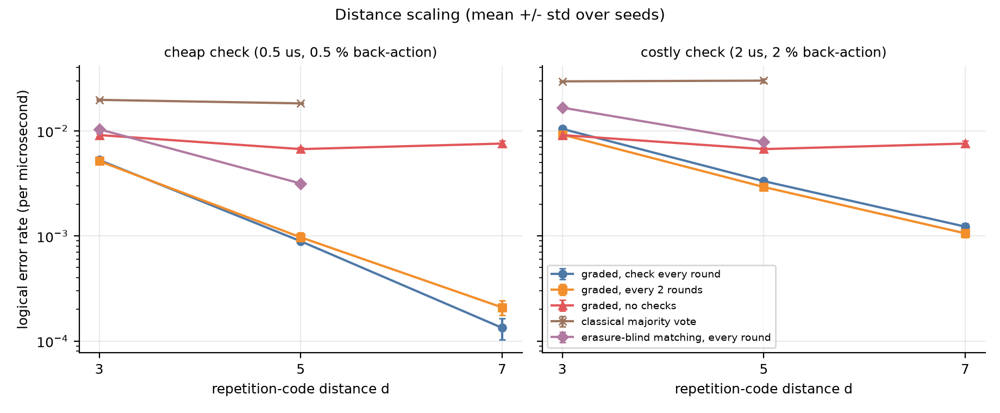
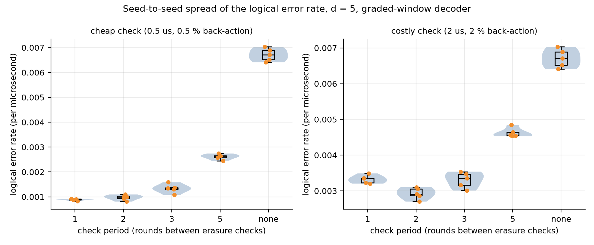
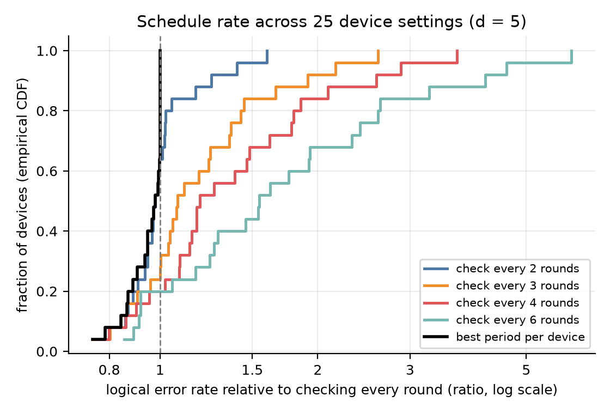
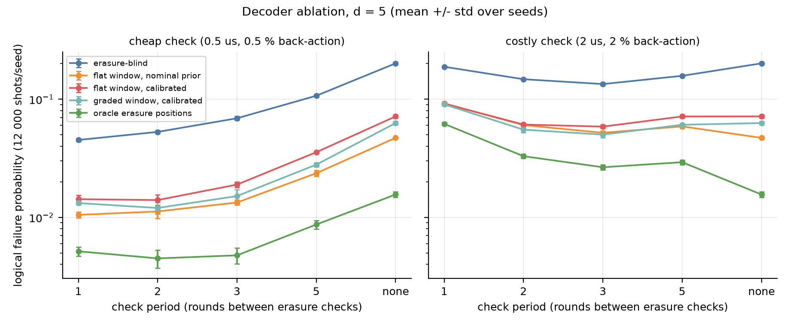

# Erasure-Check Period for a Dual-Rail Repetition-Code Memory


**Abstract.** In a dual-rail quantum memory an erasure check takes time, adds back-action, misses some erasures and, between checks, leaves an erased qubit scrambling the syndrome, so how often to check is a design choice and not a given. We simulate a repetition-code memory (distance 3 to 7) with an exact minimum-weight space-time decoder that handles flagged windows of unknown erasure time, and we sweep the check period against check cost, detection efficiency and erasure rate. Checking every round is best for cheap checks, whereas for costly checks (2 microseconds, 2 % back-action) checking every second round lowers the logical error rate per microsecond by 11.9 ± 2.7 % at distance 5 (all numbers are simulation results with the stated noise model, not hardware data).

## Summary of results

Logical error rate per microsecond (x 10^-3, mean ± standard deviation over 5 seeds), distance d = 5, 10 rounds, 12 000 shots per seed. Lower is better. Source: `results/main_scaling_agg.csv`.

| Decoder and check schedule | cheap check (0.5 µs, 0.5 % back-action) | costly check (2 µs, 2 % back-action) |
|---|---|---|
| Unencoded dual-rail qubit, no reset (analytic reference, `results/summary.json`) | 34 | 34 |
| Classical baseline: majority vote of final readout, check every round | 18.272 ± 0.272 | 30.053 ± 1.118 |
| Standard quantum baseline: erasure-blind matching, check every round | 3.157 ± 0.093 | 7.872 ± 0.135 |
| Flat-window decoder (calibrated priors), check every round | 0.964 ± 0.077 | 3.378 ± 0.085 |
| Graded-window decoder, check every round | **0.892 ± 0.036** | 3.325 ± 0.114 |
| Graded-window decoder, check every 2 rounds | 0.972 ± 0.109 | **2.926 ± 0.160** |
| Graded-window decoder, check every 3 rounds | 1.337 ± 0.179 | 3.306 ± 0.217 |
| Graded-window decoder, check every 5 rounds | 2.613 ± 0.109 | 4.627 ± 0.132 |
| Graded-window decoder, never check (free final readout only) | 6.710 ± 0.256 | 6.710 ± 0.256 |
| Oracle erasure positions, check every round (lower bound) | 0.346 ± 0.031 | 2.201 ± 0.065 |



*Figure 1. Checking less often than every round pays off only when a check is expensive in back-action; the filled contours give the error-rate reduction of the best period over period 1 at distance 5.*

## What is new here

* The **check period** of erasure detection is treated as the optimisation variable, with a time cost, a back-action cost and imperfect detection, and it is scored in logical error rate **per microsecond** rather than per round.
* A **flagged-window decoder**: a flag at a check marks every round since the previous check, and the edge priors depend on the position in the window.
* A **phase map** over check duration and check back-action, plus sweeps of detection efficiency and erasure rate, that show where "check every round" stops being optimal.
* A **negative result** on decoder calibration (see Discussion): priors calibrated on the marginal flip rate do not beat the nominal Pauli prior for the flat decoder.

## Motivation

Quantum error correction (QEC) experiments now show logical memories that improve with code size (Acharya et al., 2023, digital object identifier (DOI) 10.1038/s41586-022-05434-1; Zobrist et al., 2025, DOI 10.1038/s41586-024-08449-y) and break-even logical qubits whose own cycle adds errors (Sivak et al., 2023, DOI 10.1038/s41586-023-05782-6). Dual-rail hardware offers an extra tool: erasures, which are far easier to correct than unknown Pauli errors, can be flagged by dedicated checks inside each device. Those checks are not free, and a hardware-aware cycle has to decide how often to run them.

## Research gap

Experiments and proposals in the supplied literature treat the syndrome round as the unit of QEC (Acharya et al., 2023; Zobrist et al., 2025; Bluvstein et al., 2024, DOI 10.1038/s41586-023-06927-3; Bravyi et al., 2024, DOI 10.1038/s41586-024-07107-7). Fusion-based computation (Bartolucci et al., 2023, DOI 10.1038/s41467-023-36493-1) is designed around tolerating photon loss, which is an erasure error, and Matsumoto (2027, DOI 10.1007/s40314-026-03881-4) formalises which stabilisers erasure recovery can skip because measurements are costly. None of these report how to schedule imperfect, costly erasure checks, or how a decoder should treat a flag that only says "an erasure happened since the last check". The full related-work table with 13 papers is in [`docs/RESEARCH_GAP.md`](docs/RESEARCH_GAP.md).

## Hypotheses

* **H1.** With imperfect, costly checks there is a region of the (check duration, back-action) plane where a period above one round gives a lower logical error rate per microsecond (paired-seed gain of at least two standard errors (SE)). Falsified if no cell shows it.
* **H2.** The graded-window decoder beats the flat-window decoder with calibrated priors at periods 3 and 5.

## Method

Model: a bit-flip repetition code with d dual-rail data qubits, R = 2d rounds, phenomenological noise (erasure at rate 0.06 per microsecond, bit flips at 0.004 per microsecond, 2 % syndrome flips, detection efficiency 0.8, false-positive rate 1 %). An erased qubit scrambles its bit each round until a check detects and resets it. A round with a check lasts 1 µs plus the check duration. Decoder: an exact Viterbi minimum-weight space-time decoder over the 2^d accumulated-error states (equivalent to minimum-weight perfect matching (MWPM) on the repetition-code space-time graph) with edge weights ln((1-p)/p); a flagged qubit gets p = 1/2 (flat) or a position-dependent calibrated p (graded). Calibration uses an independent sample (8000 shots in the scaling study, 4000 in the grid and sweeps). Full details: [`docs/METHOD.md`](docs/METHOD.md).



*Legend: boxes are modules or functions of `src/erasure_schedule/`; arrows show data flow from the noise model to the saved result files and figures.*

## Results

Seeds: 5 for the scaling and ablation experiments (shots per seed 20 000, 12 000 and 4 000 at d = 3, 5, 7) and 3 for the grid and sweeps (8000 shots). Run time was 783 s in total.

### Distance scaling

Graded decoder, error rate per microsecond (x 10^-3, mean ± standard deviation, `results/main_scaling_agg.csv`):

| d | cheap check, every round | costly check, every round | costly check, every 2 rounds |
|---|---|---|---|
| 3 | 5.282 ± 0.170 | 10.443 ± 0.250 | 9.212 ± 0.086 |
| 5 | 0.892 ± 0.036 | 3.325 ± 0.114 | 2.926 ± 0.160 |
| 7 | 0.134 ± 0.031 | 1.228 ± 0.090 | 1.060 ± 0.094 |

The error rate falls by factors of 5.9 and 6.7 per distance step for the cheap check (ratios of the table entries) and about 3.2 and 2.8 for the costly check at period 2. Paired-seed gain of the best period over period 1 for the costly check: 12.6 ± 0.9 % at d = 3 (best: never check, a finite-size effect of a 6-round memory), 11.9 ± 2.7 % at d = 5 (period 2) and 13.3 ± 5.1 % at d = 7 (period 2) (`results/main_best_period.csv`). For the cheap check the best period is 1 at d = 5 and 7 and the gain at d = 3 (2.3 ± 1.9 %) is not significant.



*Figure 2. Logical error rate falls exponentially with distance for every flag-aware schedule, while the classical majority vote and the no-check schedule do not improve.*

### Seed spread



*Figure 3. For the costly check, the period-2 seeds sit below the period-1 seeds with little overlap, while for the cheap check period 1 is lowest.*

### Robustness across devices

On the 5 x 5 grid of check duration (0.25 to 4 µs) and back-action (0.2 % to 4 %), the best period is above 1 in 16 of 25 cells, and the gain is above 2 SE in 10 of 25 cells; the largest gain is 25.7 % (period 2 at 0.25 µs and 4 % back-action). Cells with back-action of 0.5 % or below have no significant gain (`results/phase_grid_best.csv`; no correction for multiple comparisons).



*Figure 4. Over the 25 device settings a period-2 schedule has at most 1.1 times the period-1 error rate in 84 % of devices (worst 1.6 times), whereas period 6 is up to 6.1 times worse and is within 1.1 times in only 24 % of devices.*

Sweeps for the costly-check device at d = 5 (`results/sweeps_best.csv`):

| Swept value | Best period | Gain over period 1 (± SE) |
|---|---|---|
| detection efficiency 0.5 / 0.7 | 1 / 1 | 0 |
| detection efficiency 0.9 | 2 | 17.4 ± 1.7 % |
| detection efficiency 0.99 | 3 | 20.6 ± 3.0 % |
| erasure rate 0.02 per µs | 6 (largest tested) | 49.1 ± 1.6 % |
| erasure rate 0.06 per µs | 2 | 15.2 ± 1.8 % |
| erasure rate 0.12 / 0.2 per µs | 1 / 1 | 0 |

### Decoder ablation

Relative reduction of the error rate per microsecond with respect to the flat-window decoder with calibrated priors, d = 5 (mean ± SE over 5 seeds, `results/decoder_ablation.csv`):

| Decoder | cheap, period 1 | cheap, period 3 | cheap, period 5 | costly, period 3 | costly, period 5 |
|---|---|---|---|---|---|
| Erasure-blind | -229 ± 8 % | -285 ± 12 % | -226 ± 4 % | -151 ± 4 % | -146 ± 3 % |
| Flat window, nominal Pauli prior | 26.5 ± 1.1 % | 29.7 ± 1.9 % | 34.5 ± 1.4 % | 12.0 ± 0.5 % | 18.8 ± 0.8 % |
| Graded window | 7.2 ± 1.8 % | 20.5 ± 3.5 % | 22.2 ± 0.7 % | 15.1 ± 2.0 % | 16.0 ± 0.7 % |
| Oracle erasure positions | 64.1 ± 1.2 % | 75.3 ± 1.3 % | 76.3 ± 0.9 % | 56.2 ± 0.4 % | 60.8 ± 0.7 % |



*Figure 5. Using the flags matters most (blind versus any flag-aware decoder), and a large gap to the oracle remains because checks miss erasures.*

## Discussion

* **H1 is supported, but only for costly checks.** With a 0.5 µs check and 0.5 % back-action, checking every round is best at d = 5 and 7. A longer period wins when each check adds roughly 1 % or more bit-flip probability, and the best period does not exceed 3 on the grid.
* **H2 is supported against the calibrated flat decoder** (20.5 ± 3.5 % and 22.2 ± 0.7 % at periods 3 and 5 for the cheap check, 15.1 ± 2.0 % and 16.0 ± 0.7 % for the costly check) **but the graded decoder is not the best decoder.** The flat decoder with the nominal Pauli prior is better than graded for the cheap check at every period, and the two are close for the costly check. Calibrating priors on the marginal flip rate therefore hurts a decoder that assumes independent edges. A plausible reason, which we did not test, is that a missed erasure scrambles its qubit in every following round, a correlated error that independent edge weights represent poorly. The headline period results use the graded decoder; with the nominal-prior flat decoder at d = 5 the costly-check gain of period 2 over period 1 is smaller (5.2 ± 2.1 %, from per-seed rates in `results/main_scaling.csv`).
* **Larger detection efficiency and lower erasure rate favour longer periods.** At efficiency 0.5 and 0.7, repeated checks give repeated chances to catch an erasure, so period 1 wins.
* **Most of the remaining error is missed erasures.** The oracle with exact erasure positions is 2.6 times lower than the graded decoder at period 1 for the cheap check (0.346 versus 0.892, in units of 10^-3 per microsecond).
* **Classical and erasure-blind baselines are far worse.** Majority vote does not improve with distance, and erasure-blind matching is 3.5 times worse than the graded decoder at d = 5 for the cheap check (3.157 versus 0.892).

## Limitations

* Classical simulation of a bit-flip repetition code with phenomenological noise, not a circuit-level surface-code or low-density parity-check (LDPC) model; no correlated errors (the limiting events in Zobrist et al., 2025), no crosstalk and no leakage beyond the erased state.
* The erased-qubit model (a fresh 50 % flip each round until reset) and all noise parameters are illustrative and not fitted to a device.
* The grid uses 3 seeds and the d = 7 point 4000 shots per seed, so the d = 7 gain (13.3 ± 5.1 %) is only 2.6 SE; multiple comparisons over 25 cells are not corrected.
* The best period at the lowest erasure rate (6) is at the edge of the tested range, so its true optimum is not located.
* Only one decoder family (independent edges) is studied; the calibration negative result is not explained by an experiment.

## Future work

Replace the repetition code with a surface or bivariate-bicycle code (the setting of Bravyi et al., 2024) and drive the check schedule from measured detection efficiency and check back-action of a multimode device; add a decoder with a persistent erased-qubit state (hyperedge or belief-propagation style) to remove the calibration penalty; and make the schedule adaptive, for example by raising the check rate after a flag. On hardware, the required inputs are the check duration, its efficiency and its back-action, all of which can be measured by randomised benchmarking style experiments.

## Reproducibility

```bash
pip install -r requirements.txt
python -m pytest -q                    # 6 tests, under 1 second
python experiments/run_all.py --quick   # smoke run, a few seconds, writes results_quick/ and figures_quick/
python experiments/run_all.py           # full study, 783 s, writes results/ and figures/
```

Hardware used: Windows 11 laptop, central processing unit (CPU) only, Python 3.11.9, numpy 2.2.6, pandas 2.3.3, matplotlib 3.11.1. All randomness is seeded (`numpy.random.default_rng([seed, stream])`). Result files: `results/main_scaling.csv`, `phase_grid.csv`, `sweeps.csv` (raw, comma-separated values), aggregated `*_agg.csv` and `*_best.csv`, `decoder_ablation.csv` and `summary.json` (JavaScript Object Notation).

## Project structure

```
src/erasure_schedule/   model.py (noise and sampling), decoder.py (Viterbi decoder, priors), runner.py
experiments/            run_all.py (one command), make_figures.py
tests/                  test_erasure_schedule.py
docs/                   RESEARCH_GAP.md, METHOD.md
results/, figures/      raw and aggregated results, five figures
.github/workflows/      ci.yml (tests and smoke run on every push)
```

## Related work by the author

* [erasure-local-stabiliser-measurements](https://github.com/pradeepdegalaroyal/erasure-local-stabiliser-measurements): how many stabiliser measurements erasure recovery needs on toric and bivariate bicycle codes. The present study instead schedules the *erasure checks* of the device.
* [imperfect-erasure-flag-decoding-toric-code](https://github.com/pradeepdegalaroyal/imperfect-erasure-flag-decoding-toric-code): matching decoding of the toric code with imperfect erasure-flag efficiency. The present study adds time cost, back-action and flag windows.

## Citation

```bibtex
@software{degala_erasure_check_period_2026,
  author  = {Degala, Chenchupradeep},
  title   = {Erasure-Check Period for a Dual-Rail Repetition-Code Memory},
  year    = {2026},
  version = {0.1.0},
  url     = {https://github.com/pradeepdegalaroyal/erasure-check-period-dual-rail-repetition-memory},
  license = {MIT}
}
```

MIT license (`LICENSE`). Citation metadata is also available in `CITATION.cff` (Citation File Format).
